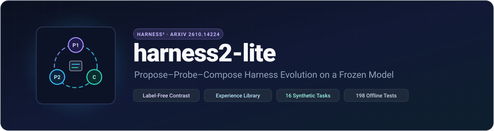
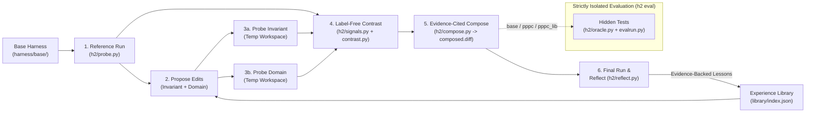

<div align="center">



[](setup.cfg)
[](https://arxiv.org/abs/2610.14224)
[](tasks/)
[](tests/)
[](https://github.com/aayushhzz/harness2-lite)

**A local implementation of _Harness²_ (Xu et al., arXiv 2610.14224): one Propose–Probe–Compose harness evolution step plus an evidence-backed experience library on a frozen model.**

[Architecture](#architecture) · [Install](#install) · [Quick Start](#quick-start) · [CLI Reference](#cli-reference) · [Evaluation Results](#evaluation-results) · [Project Structure](#project-structure) · [Deep Dive](docs/architecture.md)

</div>

---

## Overview

Instead of fine-tuning model weights, `harness2-lite` treats an agent's **harness** (`system.md`, `guardrails.md`, `tool_guidance.md`, `skills/`) as plain files that can be proposed, probed, contrasted, composed, and diffed.

The repository ships **16 synthetic Python repositories** (`10 evolve` tasks for harness evolution, `6 heldout` tasks reserved strictly for evaluation). Every evolution step is **label-free**: hidden pytest suites never enter the propose/probe/contrast/compose/reflect loop and are isolated exclusively inside `h2/oracle.py` and `h2/evalrun.py`.

> **Personal local use:** By default, `harness2-lite` drives your locally logged-in `claude` CLI on a personal Claude Pro subscription (`authMethod: claude.ai`) and strips `ANTHROPIC_API_KEY` from subprocesses. Deploying for others requires API-key authentication under Anthropic's Agent SDK terms.

## Architecture



See [docs/architecture.md](docs/architecture.md) for oracle-isolation guarantees, citation fallback rules (`source=code_fallback`), and backend implementation details.

## Install

Requires Python 3.9+. No runtime dependencies beyond the standard library and `pytest>=7` (packaged via [setup.py](setup.py) and [setup.cfg](setup.cfg)):

```bash
python3 -m venv .venv && . .venv/bin/activate
pip install -e .
h2 doctor
```

## Quick Start

### Offline Smoke Test (Deterministic Fake Backend)

Runs the full pipeline and evaluation with zero model calls:

```bash
h2 --backend fake --root /tmp/h2-demo run --tasks e01,e02
h2 --backend fake --root /tmp/h2-demo eval --limit 2
pytest
```

### Live Run (Claude CLI or Ollama)

```bash
# Single task live demo (haiku saves Pro quota)
H2_WORKER_MODEL=haiku h2 run --tasks e01
h2 show e01

# Full evolve run + held-out evaluation
H2_WORKER_MODEL=haiku h2 run --tasks evolve
h2 eval

# Optional local Ollama backend
HARNESS_BACKEND=ollama h2 run --tasks e01
```

> Each task costs ~4 agent runs + 6 editor calls. If a usage limit is hit, `h2` exits with code `3`; re-running resumes automatically at the first task without a `runs/<id>/DONE` marker.

## CLI Reference

Global flags go before the subcommand: `--backend {claude,ollama,fake}`, `--worker-model M`, `--editor-model M`, `--root DIR`.

| Command | Description |
|---|---|
| `h2 list` | Lists `<id> <group> <title>` for all 16 tasks |
| `h2 doctor` | Checks Python version, backend config, `claude auth status`, and runs a tiny structured call |
| `h2 run --tasks <evolve\|heldout\|all\|id,id> [--limit N] [--force]` | Runs Propose–Probe–Compose per task into `runs/<id>/` and updates `library/` |
| `h2 eval [--tasks heldout] [--limit N] [--force]` | Evaluates `base`, `pppc`, and `pppc_lib` (read-only library) against hidden tests -> `results.md` |
| `h2 show <task> [--arm base\|pppc\|pppc_lib]` | Renders `composed.diff` alongside cited step lines from run logs |

### Key Environment Variables

| Variable | Default | Meaning |
|---|---|---|
| `HARNESS_BACKEND` | `claude` | `claude`, `ollama`, or `fake` (`anthropic` deliberately exits with error) |
| `H2_WORKER_MODEL` | CLI default | Worker agent model (`haiku` reduces quota spend) |
| `H2_EDITOR_MODEL` | CLI default | Editor/judge model for propose, contrast, compose, reflect |
| `H2_MAX_STEPS` | `20` | Tool-call cap per agent run |
| `H2_TIMEOUT` | `240` | Wall-clock timeout (seconds) per agent run |
| `OLLAMA_WORKER_MODEL` / `OLLAMA_EDITOR_MODEL` | `qwen3:4b-instruct` / `qwen3:8b` | Local Ollama models (`OLLAMA_HOST=http://localhost:11434`) |

## Evaluation Results

Latest held-out run (`backend=claude`, `worker_model=haiku`, `n=6`, see [results.md](results.md)):

| Arm | Hidden-Test Pass | Mean Steps | Mean Tool Errors | Mean Tokens (Run) | Mean Tokens (Total) |
|---|---:|---:|---:|---:|---:|
| `base` | 6/6 (100%) | 4.0 | 0.8 | 22,922 | 22,922 |
| `pppc` | 6/6 (100%) | 3.5 | **0.0** | 21,356 | 123,447 |
| `pppc_lib` | 6/6 (100%) | **3.2** | **0.0** | 22,580 | 123,247 |

*Caveat: Single sample per cell across 6 held-out tasks with a ceiling effect on pass rate; token totals include cache reads.*

## Verifying Oracle Isolation & Running Tests

```bash
pytest                         # 198 offline tests using the fake backend
pytest tests/test_isolation.py # verifies hidden tests are unreachable outside oracle.py/evalrun.py
pytest tests/test_tasks.py     # verifies every buggy task fails hidden tests & every golden fix passes
```

## Project Structure

| Path | Description |
|---|---|
| [h2/ppc.py](h2/ppc.py) | Orchestrates the Propose–Probe–Compose–Reflect cycle |
| [h2/propose.py](h2/propose.py), [h2/probe.py](h2/probe.py), [h2/compose.py](h2/compose.py) | Candidate generation, isolated workspace probing, and evidence-cited diff composition |
| [h2/signals.py](h2/signals.py), [h2/contrast.py](h2/contrast.py) | Label-free trajectory signal extraction and behavioral contrast |
| [h2/reflect.py](h2/reflect.py), [h2/library.py](h2/library.py) | Evidence-gated reflection and keyword-indexed experience library (`library/`) |
| [h2/oracle.py](h2/oracle.py), [h2/evalrun.py](h2/evalrun.py) | Isolated hidden-test runner and 3-arm evaluator (`h2 eval`) |
| [h2/backends/](h2/backends/) | `Backend` interface with `claude_cli.py`, `ollama.py`, and `fake.py` |
| [harness/base/](harness/base/) | Starting editable harness (`system.md`, `guardrails.md`, `tool_guidance.md`, `skills/`) |
| [tasks/](tasks/) | 10 `evolve` + 6 `heldout` synthetic repos with hidden pytest suites |
| [docs/architecture.md](docs/architecture.md) | Deep dive into pipeline internals, oracle isolation, and backend contracts |

---

<div align="center">

Built by [@aayushhzz](https://github.com/aayushhzz) · [Report an Issue](https://github.com/aayushhzz/harness2-lite/issues)

</div>
